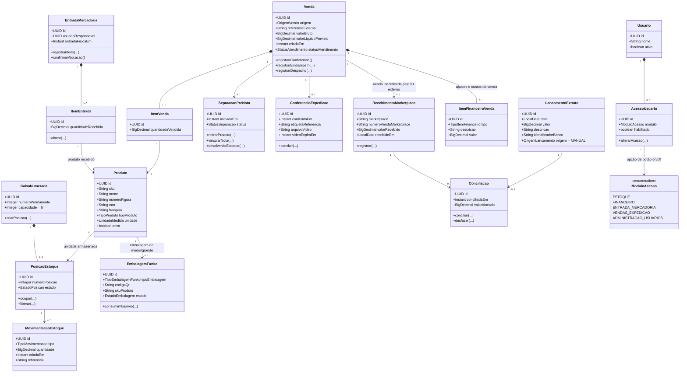

# Escopo e domínio — rascunho

Este documento inicia o levantamento do sistema. O modelo abaixo não é uma especificação fechada: termos, estados e regras devem ser confirmados com a operação da loja antes de virarem código.

## Foco e tecnologias

- **Backend:** Java e Spring Boot; principal foco da implementação.
- **Front-end:** React, em aplicação separada que consome as APIs do backend.
- **Python:** possibilidade futura para uma necessidade específica, por exemplo análise de dados ou processamento em lote.
- **Infraestrutura:** Docker para execução local. Config Server e Eureka ficam em avaliação até definirmos a topologia e o primeiro fluxo.

## Operação informada pela loja

- Loja de Funkos, action figures e Legos; um único depósito, sem controle de lote ou validade.
- Todos os produtos têm SKU e EAN únicos, além de número da figura obrigatório. A identificação deve poder ser feita por nome, franquia e número da figura. A planilha de estoque atual registra caixas numeradas de 1 a 45, com capacidade de seis Funkos normais por caixa; a numeração é permanente. Cada unidade vendida libera uma posição, e a reposição reutiliza posições vazias antes de abrir outra caixa.
- O cadastro usa o nome de produto definido pela loja, igual ao nome utilizado na Olist, e registra a franquia em campo próprio. Na entrada física, o operador digita esse nome: o sistema sugere produtos existentes e, se não houver correspondência, permite abrir o cadastro. SKU e EAN são identificadores únicos. O nome ruim da NF do fornecedor não será usado para cadastrar ou localizar os itens no primeiro fluxo de entrada.
- Funkos médios e grandes permanecem na mesma embalagem em que são armazenados; ela acompanha o produto no envio e não é reutilizada após a expedição. O modelo deve distinguir a caixa intermediária do Funko médio da caixa `SN` do Funko grande, embora ambas sejam chamadas informalmente de `SN`. A loja aprovou QR code para a embalagem grande; sua aplicação à caixa intermediária ainda está em aberto.
- Action figures ficam em uma caixa separada e não haverá novas compras; o saldo será vendido até acabar. Legos podem ficar fora do primeiro escopo.
- Vendas de e-commerce são geradas no canal de venda e seguem para o Olist, que gerencia emissão de nota fiscal e etiqueta do marketplace. O plano atual da loja não oferece acesso à API; o MVP não dependerá de integração automática.
- O recebimento financeiro de vendas de marketplace acontece dias depois da entrega. A loja precisa registrar o número da venda no marketplace e o valor que entrou no extrato para conciliar o repasse bancário com as vendas.
- O valor recebido é líquido. É mais prático registrar o líquido previsto durante o lançamento da venda, pois cada venda pode ter um valor diferente. Na Shopee o cálculo tende a ser previsível; no Mercado Livre varia mais.
- Os detalhes exibidos nas plataformas podem incluir ajustes/descontos, tarifas/comissões, frete e estornos. O sistema deve guardar valores por venda, sem pressupor uma taxa fixa por marketplace.
- Vendas presenciais são registradas manualmente. A nota fiscal presencial é emitida somente quando solicitada pelo cliente. Como o cliente leva o produto, não há etiqueta de conferência nem vídeo de embalagem para venda presencial.
- No fluxo online atual, o operador pega fisicamente o produto antes de emitir a NF para evitar emitir nota sem estoque. Cada NF corresponde a uma venda. Depois da emissão, o XML será importado manualmente no novo sistema; ID do marketplace e líquido previsto serão digitados se não estiverem no XML.
- O vídeo do processo de embalagem deve ser guardado por três meses.
- Os vídeos serão armazenados em um volume local exclusivo no servidor. O caminho definitivo será configurado quando o sistema for instalado nesse servidor.
- O extrato bancário e os créditos serão lançados manualmente no MVP.
- Hoje, após localizar e retirar o produto da caixa, a loja usa o XML da nota para gerar uma etiqueta de conferência com um programa Python próprio. Em seguida, embala o pedido, processo que é filmado.
- As operações serão feitas por usuários autenticados. O administrador define acesso liga/desliga por módulo numa tela própria.
- Devoluções e cancelamentos podem aparecer e precisam ser registrados, mesmo que o sistema só receba vendas online depois de concretizadas.

## Capacidades de negócio candidatas

1. **Catálogo:** identificar produtos e classificar seu tipo e forma de armazenagem.
2. **Estoque físico:** controlar unidades e posições das caixas numeradas, das embalagens de envio de Funko médio e grande e das caixas de saldo legado.
3. **Entrada física de mercadoria:** registrar a chegada digitando o nome do produto, selecionar um produto existente ou cadastrá-lo, informar quantidade e alocar as unidades às posições livres. O XML do fornecedor não faz parte desse fluxo inicial.
4. **Venda e separação:** registrar venda presencial manualmente e importar manualmente o XML da NF de venda online. O fluxo apoia a retirada física anterior à emissão da NF sem substituir o ciclo de pedidos do marketplace.
5. **Conferência e embalagem:** localizar e baixar itens, gerar/registrar etiqueta de conferência a partir do XML quando disponível e registrar o processo de embalagem.
6. **Pós-venda:** registrar cancelamentos e devoluções com os efeitos correspondentes no estoque.
7. **Acesso e auditoria:** autenticar usuários, autorizar operações e manter histórico do responsável pelas alterações.
8. **Financeiro/Conciliação:** lançar manualmente créditos de marketplace e relacioná-los às vendas e aos lançamentos do extrato bancário.

Essas capacidades não significam automaticamente cinco microserviços. Primeiro definimos o modelo e os limites do domínio; depois decidimos quais limites precisam de implantação independente.

## Integração com Olist no MVP

O plano atual da loja não oferece acesso à API. Portanto, o MVP funcionará sem integração automática: o operador importa manualmente o XML da NF após emiti-la no Olist. Cada NF corresponde a uma venda. O sistema tenta associar o código do produto no XML ao SKU cadastrado; se não encontrar correspondência, o usuário escolhe pelo nome e número da figura (por exemplo, “Funko Nezuko 1264”) e confirma o SKU. O ID do marketplace e o líquido previsto são campos manuais, pois não se deve presumir que estejam no XML fiscal. O XML também serve para gerar a etiqueta de conferência nas vendas expedidas.

O MVP não enviará pedidos, estoque ou notas ao Olist. A API poderá ser reavaliada se o plano mudar, mas não é dependência nem requisito desta primeira versão.

## Entrada física e busca de produto

O operador digita o nome usado no catálogo da loja e na Olist. Conforme digita, o sistema filtra os produtos existentes por nome parcial; franquia e número da figura também podem ser usados para localizar o item. Os resultados mostram nome, franquia, número da figura, SKU e EAN. Saldo e localização vêm do serviço de estoque e incluem itens com saldo zero para permitir reposição. Ao selecionar um produto, o sistema carrega seus dados e o operador informa a quantidade recebida.

Se não houver produto correspondente, o operador pode iniciar o cadastro com o nome definido pela loja (o mesmo usado na Olist) e preencher os dados de identificação: franquia, SKU único, EAN único, tipo e número da figura. Após salvar, o novo produto fica selecionável para a entrada. Para a alocação, o sistema sugere posições livres, priorizando as posições vagas de caixas já existentes; o operador pode ajustar a seleção antes de confirmar a entrada.

O XML da nota de fornecedor não é necessário para dar entrada no estoque neste primeiro fluxo. Isso evita que a descrição inconsistente do fornecedor substitua ou determine o nome de catálogo. O XML da nota de venda permanece previsto no processo de expedição quando necessário para associar a NF à venda e gerar a etiqueta de conferência.

## Vocabulário inicial

- **Produto:** item comercializado pela loja.
- **Posição de armazenagem:** lugar físico de uma unidade, como caixa 12, posição 4, ou uma caixa `SN`.
- **Entrada física de mercadoria:** registro manual da chegada, seleção ou cadastro do produto e alocação de unidades no estoque; não depende do XML do fornecedor.
- **Recebimento financeiro:** valor de uma venda ou repasse de marketplace que efetivamente entrou na conta bancária dias depois da entrega.
- **Conciliação bancária:** associação manual entre o crédito individual visto no extrato e a venda/repasse do marketplace, com valor e data registrados.
- **Venda concretizada:** venda que já ocorreu no canal de origem; não representa pedido aberto nem reserva de estoque neste sistema.
- **Movimentação de estoque:** registro imutável de entrada, venda, devolução, cancelamento ou ajuste, com quantidade, referência e data.
- **Etiqueta de conferência:** documento para conferir itens de venda expedida, atualmente gerado por ferramenta Python a partir do XML da NF. Não é necessária para venda presencial retirada pelo cliente.
- **Evidência de embalagem:** vídeo associado à venda, guardado por três meses e removido ao fim desse prazo.

Os termos acima são provisórios. Por exemplo, precisamos descobrir se a loja usa “entrada”, “nota”, “compra” ou outro conceito para representar o recebimento.

## Diagrama de classes conceitual inicial

O diagrama ainda não detalha devolução nem cancelamento. A entrada registra o usuário responsável, os produtos escolhidos do catálogo, as quantidades e as alocações físicas. O vídeo fica no volume local exclusivo do servidor; o registro mantém caminho/identificador e expiração. Para action figures, pode bastar saldo agregado da caixa legada; Lego fica fora do primeiro escopo.

## Regras candidatas para validar

1. SKU e EAN identificam cada produto de forma única, e todos os produtos têm ambos; número da figura é obrigatório para todos (confirmado).
2. Uma caixa numerada comporta até seis Funkos normais; cada posição comporta no máximo uma unidade (confirmado).
3. Ao vender um Funko normal, a posição daquela unidade fica livre. A reposição deve poder reutilizar espaços vazios antes de abrir nova caixa.
4. Novas caixas numeradas são criadas com o próximo número sequencial; os números não são renumerados nem reutilizados (numeração permanente confirmada).
5. Funkos médios e grandes são enviados na mesma embalagem em que foram armazenados. A caixa intermediária e a caixa `SN` grande são tipos distintos e são consumidas no envio. QR code está confirmado para a embalagem grande; sua aplicação à intermediária ainda será decidida.
6. Action figures são saldo legado vendável até zerar, sem reposição; Lego fica fora do escopo inicial.
7. Cada NF corresponde a uma venda. A retirada física ocorre antes da emissão; o sistema registra uma separação pré-nota e depois o usuário importa o XML/NF manualmente. Reimportar o mesmo XML não pode duplicar a venda; usar chave de acesso da NF como identificador fiscal idempotente.
8. Venda presencial concluída pode ser registrada sem NF. Como o cliente leva o produto, não há etiqueta de conferência nem vídeo de embalagem, mesmo quando a venda presencial tem NF.
9. Venda registrada baixa estoque; cancelamento/devolução pode ocorrer em qualquer etapa e exige movimentação compensatória rastreável, sem apagar a venda original.
10. Toda venda de marketplace deve guardar valor bruto e valor líquido previsto de recebimento. Componentes financeiros separados são registrados quando disponíveis.
11. Guardar, quando disponíveis, componentes financeiros por venda (por exemplo, comissão/tarifa, frete, desconto/ajuste e estorno), com valores assinados para representar descontos e créditos.
12. Não calcular o valor líquido por uma taxa fixa da Shopee ou do Mercado Livre. O valor e seus componentes podem variar por venda e devem vir da informação específica da transação ou ser lançados pelo usuário.
13. Recebimentos financeiros devem ser lançados manualmente e guardar marketplace, ID da venda, valor efetivamente creditado e data do crédito.
14. O marketplace discrimina cada venda individualmente e cada venda possui um ID; a conciliação inicial será individual: ID da venda → recebimento efetivo → lançamento do extrato.
15. O ID externo da venda deve ser único dentro do marketplace e impedir registro/concilição duplicada.
16. Comparar o valor líquido previsto com o valor efetivamente recebido e destacar diferenças para revisão, sem alterar a venda nem o crédito original.
17. Só usuários autenticados e autorizados podem registrar operações. Cada operação deve guardar o usuário responsável.
18. Vídeo da embalagem de venda expedida deve ficar associado à venda/conferência, armazenado em disco local persistente e apagado automaticamente três meses após o envio/registro. Venda presencial retirada pelo cliente não gera vídeo.
19. A entrada física é digitada pelo nome de catálogo utilizado também na Olist. A busca sugere produtos existentes; se não houver correspondência, o operador cadastra o produto com SKU único e demais dados de identificação. O XML do fornecedor não participa desse fluxo inicial.
20. A devolução só retorna ao saldo disponível depois de um operador autorizado avaliar o item. A decisão (vendável, danificado ou outra destinação) e o usuário responsável são registrados.
21. Uma tela administrativa permite cadastrar/ativar usuários e ligar/desligar acesso a cada módulo funcional por usuário. Os módulos iniciais incluem Estoque, Financeiro, Entrada de Mercadoria, Vendas/Expedição e Administração de Usuários; novos módulos podem acrescentar seus próprios controles. Apenas o administrador pode acessar essa tela e alterar os acessos.
22. Corrigir dados do mesmo produto mantém seu ID e registra campo, valor anterior, valor novo, usuário, data e motivo. Um novo produto é criado quando a identidade do item é realmente diferente; não se inativa e recria um produto apenas por erro de digitação.
23. Os itens de venda preservam nome e SKU usados no momento da venda, para que correções posteriores no Catálogo não alterem a apresentação do histórico comercial.
24. Na entrada, o sistema sugere posições livres existentes e permite que o operador ajuste a alocação antes de confirmar.

São regras candidatas. Precisamos validar em especial devolução parcial, o momento exato da baixa do saldo, e como corrigir erros sem perder o histórico.

## Fluxo operacional desejado (rascunho)

1. Mercadoria chega fisicamente à loja; o operador digita o nome de cada produto, seleciona um produto existente ou abre o cadastro e informa a quantidade. O sistema sugere posições livres, priorizando espaços em caixas existentes; o operador pode ajustar a sugestão antes de confirmar a alocação. A entrada não depende do XML do fornecedor.
2. Para venda online, operador inicia uma separação pré-nota, localiza e retira fisicamente o produto. A venda só é confirmada quando a NF/XML for emitida e importada manualmente.
3. O sistema orienta a localização: caixa numerada/posição, caixa intermediária de Funko médio, embalagem `SN` de Funko grande ou caixa de action figures. A posição/embalagem é marcada como em separação para evitar inconsistência durante a emissão da NF.
4. Após emitir NF no Olist, operador faz upload do XML para associá-lo à separação. O utilitário Python atual usa o XML para gerar a etiqueta de conferência; avaliar reaproveitar ou substituir essa função. O ID do marketplace e o líquido previsto são informados manualmente na venda.
5. Operador confere e embala. Para Funkos médios e grandes, a embalagem de armazenagem acompanha o produto e é marcada como consumida. O vídeo é associado ao registro e apagado automaticamente após 3 meses.
6. Sistema confirma a venda, baixa o estoque e registra usuário responsável. Cancelamento ou devolução posterior gera movimentação compensatória rastreável.
7. Venda presencial é registrada manualmente; pode não ter NF. Como o cliente leva o produto, não há etiqueta de conferência nem vídeo de embalagem. Se houver NF, o registro fiscal pode ser associado à venda, sem criar tarefa de conferência/embalagem.
8. Ao importar manualmente a venda, o operador registra o líquido previsto e os componentes financeiros disponíveis para aquela venda.
9. Dias depois, operador consulta o extrato bancário e lança manualmente o crédito individual, informando ID da venda, valor efetivamente recebido e data. O sistema compara com o líquido previsto e registra a conciliação.

Este fluxo ainda precisa ser ajustado ao momento em que o Olist disponibiliza a venda, NF e etiqueta e à forma de despacho do marketplace.

## Decisões técnicas para a implantação

- O caminho do volume exclusivo de vídeos será configurado quando o sistema for instalado no servidor; a regra de retenção de três meses já está definida.
- As permissões são definidas por módulo funcional na tela administrativa: inicialmente Estoque, Financeiro, Entrada de Mercadoria, Vendas/Expedição e Administração de Usuários. O conjunto pode crescer com novas áreas.

## Próximos artefatos de análise

O escopo, os fluxos e os limites dos serviços já orientam a implementação. A primeira fatia está no `catalog-service`; a entrada física e a alocação de estoque serão o próximo domínio funcional depois de concluir e validar a API básica do catálogo.
