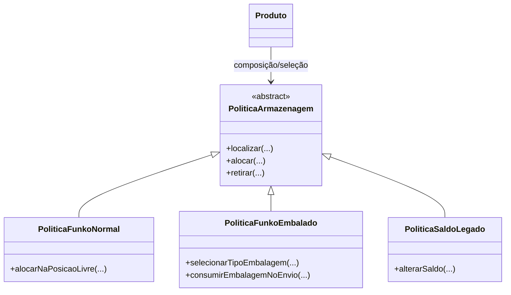
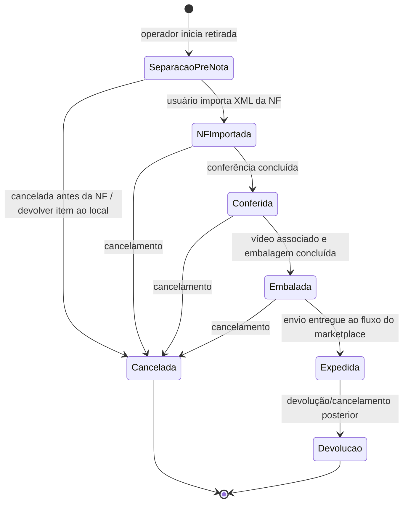
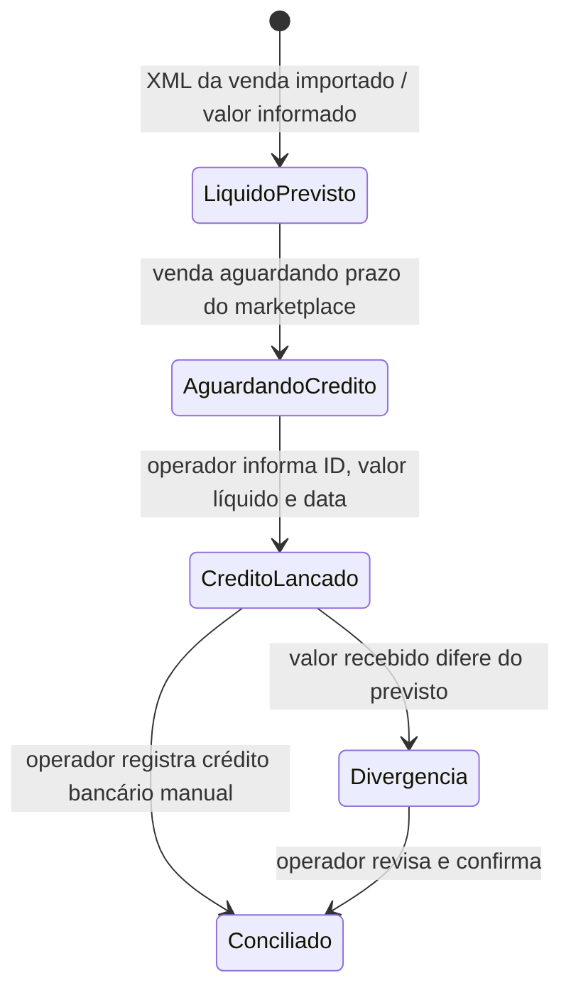

# Modelo do domínio e fluxos

Este documento detalha o rascunho de [escopo e domínio](01-escopo-e-dominio.md). Ele descreve conceitos de negócio, não classes Java finais nem tabelas. Os detalhes podem ser ajustados quando implementarmos a primeira fatia.

## Limites funcionais iniciais

As primeiras áreas do sistema são:

- **Catálogo:** nome definido pela loja, franquia, SKU, EAN/código de barras, tipo e número da figura.
- **Estoque:** entrada física, endereço da unidade e histórico de movimentação.
- **Venda e expedição:** retirada pré-nota, importação manual do XML da NF, conferência e embalagem.
- **Financeiro:** valor líquido previsto por venda, crédito individual posterior e conciliação manual.
- **Acessos:** usuários e permissões liga/desliga por módulo, mantidos numa tela de administração.

O Olist continua cuidando de pedidos de marketplace, emissão fiscal e etiqueta de transporte. O sistema novo apoia o processo físico e importa XML manualmente; não depende da API.

## Classes conceituais

| Classe | Responsabilidade e comportamento |
| --- | --- |
| `Produto` | Identidade do item no catálogo: nome da loja, franquia, SKU único, EAN único, tipo e número da figura obrigatório. A busca pode usar nome parcial, franquia ou número da figura. |
| `HistoricoAlteracaoProduto` | Registra correções com campo, valor anterior e novo, usuário, data e motivo. O ID do produto permanece estável. |
| `EntradaMercadoria` | Registra o recebimento físico digitado pelo operador; sugere posições livres e só confirma o estoque depois de o operador revisar e confirmar a alocação. |
| `ItemEntrada` | Guarda o produto selecionado do catálogo, a quantidade recebida e as posições sugeridas/ajustadas pelo operador. |
| `CaixaNumerada` | Caixa Funko normal com número permanente e seis posições reutilizáveis. Uma caixa vazia continua existindo e pode ser reabastecida. |
| `PosicaoEstoque` | Uma posição de uma caixa numerada; contém zero ou um Funko normal. A posição vazia volta a ficar disponível após a venda. |
| `EmbalagemFunko` | Embalagem de armazenagem e envio de Funko médio ou grande. O tipo diferencia a caixa intermediária da caixa `SN` grande; acompanha o produto e é consumida no envio. QR foi confirmado para a caixa grande; aplicação à intermediária está em aberto. |
| `SaldoLegado` | Quantidade agregada de action figures ainda vendáveis, sem reposição. Lego fica fora do primeiro escopo. |
| `SeparacaoPreNota` | Retirada física iniciada antes da emissão da NF. Mantém temporariamente os itens em separação; pode ser vinculada ao XML ou desfeita. |
| `Venda` | Venda presencial lançada manualmente ou venda expedida confirmada pela importação do XML da NF. Guarda origem, NF, ID externo quando houver, itens e valores financeiros. |
| `ItemVenda` | Produto, quantidade, valores e cópia de nome/SKU do catálogo no momento da venda, preservando o histórico comercial. |
| `ItemFinanceiroVenda` | Componentes específicos da transação, como tarifa, frete, desconto/ajuste ou estorno; valores não são calculados por taxa fixa. |
| `ConferenciaExpedicao` | Conferência e embalagem de venda expedida; pode ter etiqueta e vídeo. A venda presencial retirada pelo cliente não cria esse registro. |
| `RegistroVideo` | Caminho no volume local do servidor, data do envio e expiração três meses depois. |
| `MovimentacaoEstoque` | Registro imutável de entrada, venda, devolução ou ajuste, com produto, quantidade, local, data e usuário responsável. |
| `AvaliacaoDevolucao` | Decisão de operador autorizado sobre o item devolvido: volta ao estoque vendável, fica danificado ou outra destinação registrada. |
| `RecebimentoMarketplace` | Crédito líquido individual identificado pelo marketplace e ID da venda, com valor e data efetivamente recebidos. |
| `LancamentoExtrato` | Crédito bancário lançado manualmente, com data, valor e descrição/identificador digitados pelo operador. |
| `Conciliacao` | Associação um a um entre recebimento de uma venda e crédito no extrato; destaca diferença em relação ao líquido previsto. |
| `Usuario`, `ModuloAcesso` (enum), `AcessoUsuario` | Usuário autenticado; enum fixo com módulos acessíveis; associação persistida por usuário com estado habilitado/desabilitado configurado pelo administrador. |

## Diagrama de classes conceitual

```mermaid
classDiagram
    class Produto {
        -UUID id
        -String sku
        -String ean
        -String nomeCatalogo
        -String numeroFigura
        -String franquia
        -TipoProduto tipoProduto
        +corrigirNome(...)
        +corrigirSku(...)
        +corrigirEan(...)
    }
    class HistoricoAlteracaoProduto {
        -UUID id
        -UUID produtoId
        -String campo
        -String valorAnterior
        -String valorNovo
        -UUID usuarioId
        -Instant alteradoEm
        -String motivo
    }
    class TipoProduto {
        <<enumeration>>
        FUNKO_NORMAL
        FUNKO_MEDIO
        FUNKO_GRANDE
        ACTION_FIGURE
    }
    class EntradaMercadoria {
        -UUID id
        -Instant recebidaEm
        -UUID usuarioResponsavel
        +adicionarItem(...)
        +alocarItem(...)
        +confirmarEntrada(...)
    }
    class ItemEntrada {
        -UUID produtoId
        -BigDecimal quantidade
        +alocar(...)
    }
    class CaixaNumerada {
        -Integer numeroPermanente
        -Integer capacidade
        +proximaPosicaoLivre()
    }
    class PosicaoEstoque {
        -Integer numero
        -EstadoPosicao estado
        +ocupar(...)
        +liberar(...)
        +marcarEmSeparacao(...)
    }
    class EmbalagemFunko {
        -TipoEmbalagemFunko tipoEmbalagem
        -String codigoQR
        -EstadoEmbalagem estado
        +reservarParaSeparacao(...)
        +consumirNoEnvio(...)
    }
    class SaldoLegado {
        -BigDecimal quantidade
        +baixar(...)
        +devolver(...)
    }
    class SeparacaoPreNota {
        -UUID id
        -EstadoSeparacao estado
        +retirar(...)
        +vincularNota(...)
        +desfazer(...)
    }
    class Venda {
        -UUID id
        -OrigemVenda origem
        -String chaveNFe
        -String idMarketplace
        -BigDecimal valorBruto
        -BigDecimal liquidoPrevisto
        -EstadoVenda estado
        +confirmarPorNFe(...)
        +registrarConferencia(...)
        +cancelar(...)
    }
    class ItemVenda {
        -String nomeProdutoNoMomentoDaVenda
        -String skuNoMomentoDaVenda
        -BigDecimal quantidade
        -BigDecimal valorBruto
    }
    class ItemFinanceiroVenda {
        -TipoItemFinanceiro tipo
        -BigDecimal valor
        -String descricao
    }
    class ConferenciaExpedicao {
        -Instant conferidaEm
        +conferir(...)
        +embalar(...)
    }
    class RegistroVideo {
        -String caminhoLocal
        -Instant enviadoEm
        -Instant expiraEm
        +apagarSeExpirado(...)
    }
    class MovimentacaoEstoque {
        -TipoMovimentacao tipo
        -BigDecimal quantidade
        -Instant criadaEm
        -String referencia
    }
    class AvaliacaoDevolucao {
        -EstadoProdutoDevolvido resultado
        -String motivo
        +registrarDecisao(...)
    }
    class RecebimentoMarketplace {
        -String idMarketplace
        -BigDecimal valorLiquidoRecebido
        -LocalDate recebidoEm
        +registrarCredito(...)
    }
    class LancamentoExtrato {
        -LocalDate data
        -BigDecimal valor
        -String descricao
        +registrarManualmente(...)
    }
    class Conciliacao {
        -Instant conciliadaEm
        -BigDecimal diferenca
        +conciliar(...)
        +desfazer(...)
    }
    class Usuario {
        -UUID id
        -String nome
        -boolean ativo
    }
    class ModuloAcesso {
        <<enumeration>>
        ESTOQUE
        FINANCEIRO
        ENTRADA_MERCADORIA
        VENDAS_EXPEDICAO
        ADMINISTRACAO_USUARIOS
    }
    class AcessoUsuario {
        -ModuloAcesso modulo
        -boolean habilitado
        -UUID alteradoPor
        -Instant alteradoEm
        +habilitar()
        +desabilitar()
    }

    EntradaMercadoria "1" *-- "1..*" ItemEntrada
    ItemEntrada "*" --> "1" Produto : selecionado no catálogo
    CaixaNumerada "1" *-- "6" PosicaoEstoque
    Produto "1" --> "0..*" PosicaoEstoque
    Produto "1" --> "0..*" EmbalagemFunko
    Produto --> TipoProduto
    Produto "1" *-- "0..*" HistoricoAlteracaoProduto
    Produto "1" --> "0..1" SaldoLegado
    SeparacaoPreNota "1" --> "1..*" PosicaoEstoque
    SeparacaoPreNota "1" --> "0..*" EmbalagemFunko
    SeparacaoPreNota "0..1" --> "0..1" Venda : confirmada pelo XML
    Venda "1" *-- "1..*" ItemVenda
    Venda "1" *-- "0..*" ItemFinanceiroVenda
    ItemVenda "*" --> "1" Produto
    Venda "1" --> "0..1" ConferenciaExpedicao
    ConferenciaExpedicao "1" --> "0..1" RegistroVideo
    Venda "1" --> "0..*" MovimentacaoEstoque
    Venda "1" --> "0..1" RecebimentoMarketplace
    RecebimentoMarketplace "1" --> "0..1" Conciliacao
    LancamentoExtrato "1" --> "0..1" Conciliacao
    Usuario "1" --> "0..*" MovimentacaoEstoque : autor
    Usuario "1" *-- "0..*" AcessoUsuario
    AcessoUsuario "*" --> "1" ModuloAcesso
    AcessoUsuario "0..*" --> "1" Usuario : alteradoPor
    Usuario "1" --> "0..*" AvaliacaoDevolucao : avaliador
```



## Permissões em Java

Sim. Os módulos de acesso são uma boa aplicação para `enum`, pois representam as áreas disponíveis no próprio sistema. `Usuario` continua sendo uma entidade comum, com identidade, nome e estado ativo; ele não é enum.

```java
public enum ModuloAcesso {
    ESTOQUE,
    FINANCEIRO,
    ENTRADA_MERCADORIA,
    VENDAS_EXPEDICAO,
    ADMINISTRACAO_USUARIOS
}
```

O botão liga/desliga é um estado por usuário e fica persistido numa associação como `AcessoUsuario` (`usuario_id`, `modulo`, `habilitado`). Na entidade, a mudança acontece por métodos de negócio (`habilitarAcesso`, `desabilitarAcesso`, `possuiAcesso`), sem setters públicos. O enum fica salvo pelo nome (`EnumType.STRING`), nunca pelo índice numérico.

Assim, o administrador liga/desliga módulos existentes sem alterar código. Quando uma nova área funcional for implementada, adicionamos seu valor ao enum e a opção correspondente na tela; os acessos de cada usuário continuam persistidos separadamente.

## Herança e padrões

O domínio não precisa criar subclasses só para cada nome de produto. A variação do armazenamento pode usar uma estratégia polimórfica:



Isso permite usar herança e polimorfismo para regras que realmente variam por forma de armazenagem. `Produto` continua sendo uma identidade única de catálogo; não duplicamos cada item em subclasses rígidas. A classe abstrata e as concretas podem virar interface e implementações em Java se isso ficar mais simples durante a implementação.

Padrões que têm aplicação concreta aqui:

- **Strategy:** política de alocação/retirada conforme produto normal, grande ou saldo legado.
- **Factory/Registry:** escolhe a política pelo tipo de armazenagem do produto ao carregar/configurar o catálogo.
- **State:** controla os estados da separação pré-nota, venda e embalagem com transições explícitas.
- **Adapter:** encapsula a leitura do XML NF-e para que o domínio não dependa da biblioteca de parsing.
- **Repository:** persiste e consulta agregados sem expor detalhes do banco às regras de negócio.

Nenhum padrão exige setters. As entidades mudam por ações de negócio (`alocar`, `confirmarEntrada`, `vincularNota`, `cancelar`, `corrigirNome`, `registrarCredito`). Uma correção mantém o ID de `Produto`; um registro de histórico guarda antes/depois e autoria. O caso de uso coordena alteração, persistência e histórico, sem fazer a entidade depender de HTTP, banco ou logger.

## Estados do atendimento

### Venda online



O sistema registra cancelamento/devolução em qualquer etapa. Se o item retorna fisicamente, um operador autorizado decide e registra se volta ao saldo vendável; a venda e as movimentações originais não são apagadas.

### Recebimento financeiro



## Regras de consistência que devem virar código

1. Todos os produtos têm SKU e EAN únicos; o número da figura também é obrigatório.
2. A entrada é registrada manualmente: a busca pode filtrar por nome parcial, franquia ou número da figura e mostra SKU, EAN e saldo/localização para confirmar a escolha.
3. Se não encontrar o produto, o operador pode cadastrá-lo com o nome usado na loja e na Olist, franquia, SKU, EAN, tipo e número da figura.
4. O XML do fornecedor não é requisito para registrar a entrada física; nomes e códigos fiscais do fornecedor não alteram o cadastro do produto.
5. Uma caixa numerada tem seis posições; cada posição aceita zero ou uma unidade. Seu número é permanente e as posições vazias são reutilizadas antes de abrir uma nova caixa.
6. Na entrada, o sistema sugere posições vazias existentes antes de propor uma nova caixa; o operador pode ajustar a seleção antes de confirmar.
7. Funkos médios e grandes são enviados na mesma embalagem em que foram armazenados. A caixa intermediária e a caixa `SN` grande são tipos distintos e são consumidas no envio.
8. Separação pré-nota retira a unidade do endereço disponível, mas não confirma uma venda nem baixa definitivamente o saldo até o XML/NF ser associado. Se cancelada antes da NF, o operador devolve a unidade ao endereço e o sistema registra a movimentação.
9. Importar novamente a mesma chave de acesso de NF não duplica uma venda.
10. ID externo de marketplace é único dentro daquele marketplace; crédito e conciliação não podem ser duplicados.
11. Valor líquido previsto e efetivamente recebido são dados separados. Diferenças ficam visíveis e auditáveis.
12. Crédito bancário é lançado manualmente no MVP e conciliado a uma venda por vez.
13. Devoluções só afetam o saldo vendável depois da avaliação registrada por operador autorizado.
14. Toda movimentação ou alteração relevante registra usuário e data/hora.
15. Vídeo de expedição é local, não vai ao banco de dados, e é apagado três meses após ser gravado. Venda presencial sem embalagem não cria vídeo.
16. Acesso é configurado por administrador com permissões liga/desliga por módulo funcional; módulos novos podem acrescentar permissões.

## Próxima validação

As decisões iniciais já foram documentadas e a implementação começou pelo `catalog-service`. O modelo de `Produto` foi separado da entidade JPA; o repositório e o adaptador fazem a persistência; `ProdutoService` coordena as operações e `ProdutoValidator` concentra as regras de unicidade. As rotas de catálogo foram exercitadas manualmente contra PostgreSQL. Em 19/11, `mvn test` passou com 23 testes de contexto, service e validação. O próximo recorte é padronizar os erros HTTP, testar o controller e depois desenhar a entrada física e a alocação nas caixas/posições.
