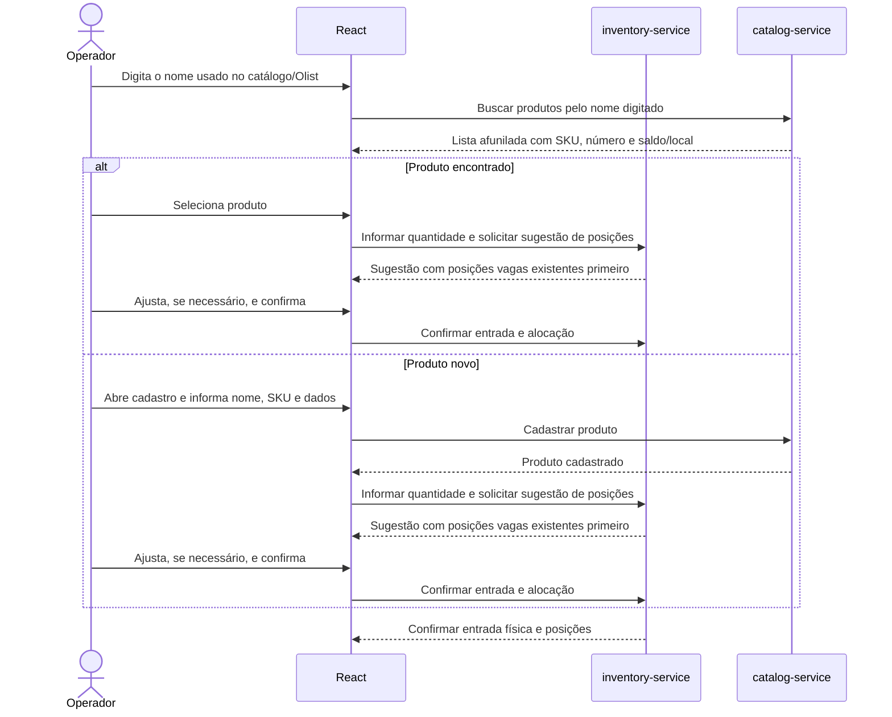

# Proposta de fronteiras dos serviços

## Regra para dividir

Um microserviço representa uma capacidade de negócio e é dono dos dados e das regras dessa capacidade. Não criamos um serviço por classe Java nem compartilhamos tabelas entre serviços. As entidades do modelo de domínio viram classes dentro dos serviços que as possuem.

## Serviços de negócio propostos

| Serviço | Dono dos dados e regras | Não é responsável por |
| --- | --- | --- |
| `catalog-service` | Produtos: nome usado pela loja e na Olist, SKU, EAN/código de barras e número da figura. | Saldos e localizações físicas. |
| `inventory-service` | Entrada física digitada, caixas numeradas e posições, embalagens de envio distintas para Funkos médios e grandes, saldo legado, movimentações e separação pré-nota física. | Valor líquido de marketplace e conciliação bancária. |
| `sales-fulfillment-service` | Venda presencial, importação manual do XML da NF de venda, ID do marketplace, conferência, embalagem, vídeo e registro de cancelamento/devolução. | Saldo e posição física como fonte de verdade. |
| `finance-service` | Líquido previsto e componentes da venda, crédito individual recebido e conciliação manual com o extrato. | Cadastro de produtos ou localização de estoque. |
| `identity-access-service` | Usuários, autenticação, enum dos módulos e acessos liga/desliga por usuário. | Regras de negócio de estoque, expedição ou financeiro. |

`sales-fulfillment-service` mantém o registro comercial da venda; `inventory-service` mantém o estado físico. O processo pré-nota pertence ao estoque porque marca a posição real enquanto o operador retira o produto. A importação da NF confirma a venda e faz o estoque finalizar a baixa.

## Infraestrutura, fora dos serviços de negócio

- `api-gateway`: entrada HTTP usada pelo React; valida autenticação e encaminha chamadas aos serviços. Os próprios serviços também verificam a autorização do módulo para a ação solicitada.
- `config-server`: centraliza configuração externa dos serviços.
- `discovery-server`: Eureka para registro e descoberta dos serviços.
- `observability`: Grafana, Loki, Prometheus, Tempo e Alloy para dashboards, logs, métricas e rastros. É infraestrutura compartilhada, separada das regras dos serviços de negócio.
- `rabbitmq`: broker de mensageria com filas duráveis para distribuir eventos de negócio entre serviços.
- `frontend`: aplicação React consumindo as APIs pelo gateway.
- `docker-compose`: execução local das aplicações, bancos e infraestrutura.

Esses componentes não são domínios da loja e não devem conter regra de produto, venda ou estoque.

## Fluxos entre serviços

### Entrada física manual

### Venda e retirada física

1. O operador inicia a retirada no `inventory-service`, que identifica e marca a posição ou embalagem como em separação.
2. Depois de emitir a NF no Olist, importa o XML no `sales-fulfillment-service` e associa a venda à separação já aberta.
3. O `sales-fulfillment-service` salva a venda e um evento `VendaConfirmada` na mesma transação local. O evento contém IDs, marketplace, ID externo e valor bruto, sem XML nem dados pessoais do cliente.
4. Um publicador envia o evento ao RabbitMQ. O `inventory-service` consome para finalizar a baixa; o `finance-service` cria o registro financeiro vinculado à venda para o operador completar o líquido previsto e os componentes.
5. Se Inventory ou Finance estiver indisponível, a fila mantém o evento até que o consumidor volte. A tela informa que a integração está pendente; outros serviços e operações não precisam parar.
6. Depois de gravar a baixa, Inventory publica `BaixaEstoqueConfirmada`; Vendas consome para atualizar o estado mostrado ao operador.
7. Mais tarde, o `finance-service` associa o crédito lançado manualmente ao lançamento de extrato registrado pelo operador.

## Mensageria e recuperação de falhas

O padrão recomendado é mensageria assíncrona com **RabbitMQ**, eventos duráveis e filas persistentes. É adequado para avisar outros serviços que um fato de negócio ocorreu; não substitui chamadas HTTP quando a tela precisa de uma resposta imediata, como pesquisar o estoque.

Eventos iniciais candidatos:

- `VendaConfirmada`: publicado pelo serviço de vendas; consumido por Estoque e Financeiro.
- `BaixaEstoqueConfirmada`: publicado por Estoque após persistir a baixa; consumido por Vendas para atualizar o estado de integração da venda.
- `VendaCancelada`: publicado pelo serviço de vendas/pós-venda; consumido por Estoque para registrar a movimentação compensatória quando aplicável.
- `DevolucaoAvaliada`: publicado pelo serviço de vendas/pós-venda; consumido por Estoque quando o operador decide a destinação do produto.

Regras para a entrega confiável:

1. Cada evento tem `messageId`, tipo, versão do contrato, data/hora, ID do agregado e `correlationId`/`traceId` para observabilidade.
2. O serviço que gera o evento grava a mudança de negócio e uma linha de **outbox** na mesma transação de banco. Um publicador separado envia a outbox ao RabbitMQ e marca como publicada após receber publisher confirm. Se RabbitMQ estiver fora, a outbox fica pendente e tenta novamente.
3. Filas são duráveis e mensagens persistentes. O RabbitMQ mantém as mensagens não consumidas se um serviço parar e a fila fica guardada no volume persistente do broker.
4. Consumidor confirma (ack) a mensagem só depois de concluir e persistir o processamento. Se o processo cair antes do ack, o broker pode entregar a mesma mensagem novamente.
5. Cada consumidor é idempotente: guarda `messageId` processado, com restrição única, e/ou usa a chave de negócio (por exemplo, chave NF + tipo de movimento) para não duplicar venda ou baixa.
6. Falhas temporárias recebem retentativas com espera crescente. Depois do limite, a mensagem vai para uma **dead-letter queue (DLQ)** em vez de voltar em loop infinito. A DLQ deve gerar alerta e permitir correção e reprocessamento pelo administrador.
7. Chamadas de leitura e respostas imediatas ficam em HTTP; eventos notificam fatos já confirmados. Nenhum serviço consulta tabelas de outro serviço.

Uma instalação local com um único RabbitMQ e volume persistente permite recuperar mensagens após reiniciar o container ou um consumidor. Isso não protege contra perda do servidor ou do disco; para maior disponibilidade em produção, avaliar filas replicadas (quorum), redundância do host e cópias de segurança.

O padrão oferece entrega **pelo menos uma vez**, não uma promessa de execução exatamente uma vez. Confirmações, persistência, outbox e idempotência tornam repetição segura. RabbitMQ documenta filas duráveis/mensagens persistentes, publisher confirms e consumer acknowledgements; Spring AMQP suporta retentativas e encaminhamento a DLQ. [Confiabilidade e confirmações RabbitMQ](https://www.rabbitmq.com/docs/reliability), [filas duráveis](https://www.rabbitmq.com/docs/queues), [retentativas e falhas Spring AMQP](https://docs.spring.io/spring-amqp/reference/amqp/resilience-recovering-from-errors-and-broker-failures.html).

## Propriedade dos dados

- `catalog-service`: `Produto`.
- `inventory-service`: `EntradaMercadoria`, `ItemEntrada`, `CaixaNumerada`, `PosicaoEstoque`, `EmbalagemFunko`, `SaldoLegado`, `SeparacaoPreNota`, `MovimentacaoEstoque`.
- `sales-fulfillment-service`: `Venda`, `ItemVenda`, `ConferenciaExpedicao`, `RegistroVideo`, `AvaliacaoDevolucao`.
- `finance-service`: `ItemFinanceiroVenda`, `RecebimentoMarketplace`, `LancamentoExtrato`, `Conciliacao`.
- `identity-access-service`: `Usuario`, `ModuloAcesso`, `AcessoUsuario`.

Identificadores de produto e venda são referenciados entre serviços por IDs estáveis e códigos externos; não por relacionamento SQL entre bancos.

## Persistência e execução local

Cada serviço é dono de seu banco lógico e de suas migrações. Para desenvolvimento, podemos executar um único servidor PostgreSQL no Docker Compose com bancos separados por serviço; isso reduz configuração local sem compartilhar tabelas ou permissões entre serviços. Em produção, o volume local de vídeos será montado para o serviço de expedição e terá o caminho definido na instalação.

No primeiro protótipo, usaremos HTTP síncrono apenas para consultas/comandos que exigem retorno imediato e RabbitMQ para eventos entre serviços. Broker, outbox e monitoramento da fila fazem parte da infraestrutura local em Docker Compose.

## Primeira fatia recomendada

Começar por `catalog-service` + `inventory-service`:

1. Buscar produto pelo nome usado na loja e na Olist.
2. Selecionar produto existente ou cadastrar um novo com SKU e dados de identificação.
3. Informar a quantidade recebida e pedir ao sistema uma sugestão de posições livres.
4. Revisar ou ajustar a sugestão e confirmar a entrada; criar caixas numeradas somente quando necessário e consultar saldo/localização.

Depois, o fluxo de venda usa os dados e localizações já confiáveis. A arquitetura dos serviços pode ser revista se uma regra real mostrar que dois limites precisam mudar.
