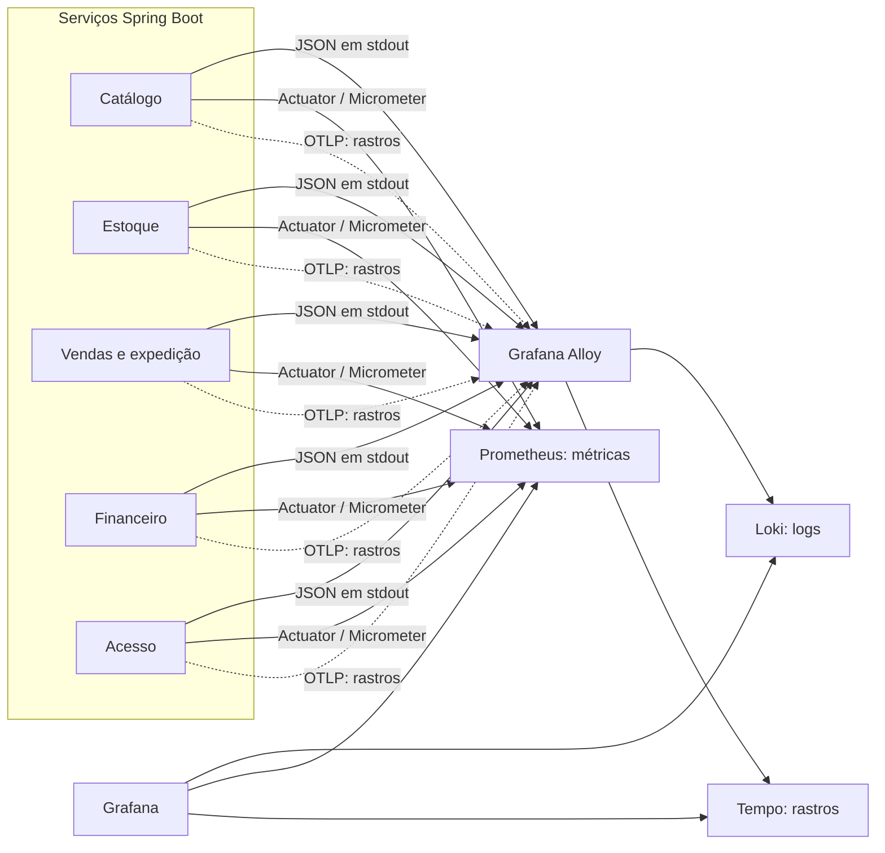

# Observabilidade: logs, métricas e rastros

## Objetivo

Permitir acompanhar todos os serviços Java numa única interface: encontrar erros, ver saúde e desempenho e seguir uma requisição entre serviços. A stack roda em Docker Compose no desenvolvimento e pode ser instalada no servidor junto com a aplicação.

## Stack proposta

| Ferramenta | Papel |
| --- | --- |
| **Grafana** | Tela única para dashboards, consultas e alertas. |
| **Loki** | Armazena e pesquisa logs dos containers. |
| **Grafana Alloy** | Coleta logs dos containers e encaminha logs/rastros aos destinos configurados. |
| **Prometheus** | Coleta métricas das aplicações Java por scraping do endpoint interno do Actuator. |
| **Tempo** | Armazena rastros distribuídos e permite visualizar uma requisição atravessando os serviços. |
| **Spring Boot Actuator + Micrometer** | Expõe métricas e instrumenta aplicações Spring. Micrometer Tracing adiciona IDs de correlação e pode exportar rastros via OTLP. |

Grafana não armazena os logs por si só: consulta Loki, Prometheus e Tempo como fontes de dados. A documentação da Grafana recomenda Alloy como caminho de coleta para Loki e descreve o uso de Tempo para rastreamento distribuído. [Alloy e Loki](https://grafana.com/docs/loki/latest/send-data/alloy/), [Tempo](https://grafana.com/docs/tempo/latest/).

## Fluxo dos dados

Spring Boot Actuator integra Micrometer e disponibiliza o endpoint Prometheus quando habilitado; esse endpoint não fica exposto por padrão. O endpoint deve estar disponível apenas na rede interna de monitoramento. O Spring Boot também inclui `traceId` e `spanId` nos logs ao usar Micrometer Tracing, o que permite localizar no Tempo o rastro relacionado ao erro no Loki. [Métricas Spring Boot](https://docs.spring.io/spring-boot/reference/actuator/metrics.html), [correlação de rastros e logs](https://docs.spring.io/spring-boot/reference/actuator/tracing.html).

## Formato e campos de log

- Cada serviço escreve logs estruturados em JSON para `stdout`/`stderr`; o container não mantém um arquivo de log próprio como fonte principal.
- Campos padrão: `timestamp`, `level`, `service`, `environment`, `message`, `traceId`, `spanId` e `error` com tipo, mensagem e stack trace quando necessário.
- Quando ajudar a investigar uma operação, incluir IDs internos como `vendaId` ou `movimentacaoId` como campos JSON pesquisáveis, não como labels do Loki.
- Labels Loki de baixa cardinalidade: `service` e `environment`; `level` pode ser usado se os dashboards precisarem.
- Não usar como labels valores únicos ou muito variados, como `traceId`, `usuarioId`, ID de venda, IP ou texto de erro. Esses campos ficam no corpo/metadata estruturada do log. A documentação Loki alerta que labels de alta cardinalidade prejudicam índice e desempenho. [Cardinalidade no Loki](https://grafana.com/docs/loki/latest/get-started/labels/cardinality/).
- Não gravar tokens, senhas, XML inteiro, CPF, endereço, nome de cliente ou outros dados pessoais em logs. Registrar IDs técnicos e resumos suficientes para diagnosticar.

## Logs técnicos e auditoria de negócio

São registros diferentes e devem continuar separados:

- **Logs técnicos:** falhas, chamadas, tempos e diagnósticos pesquisáveis no Loki; sua retenção pode ser curta e operacional.
- **Auditoria de negócio:** quem alterou estoque, confirmou recebimento, avaliou devolução ou mudou permissões. Esses registros ficam persistidos no banco de domínio pelo prazo definido para o negócio, não são recuperados dos logs do Loki.

Uma operação importante deve gravar a alteração de domínio e sua auditoria de forma transacional no serviço dono do dado. Os logs ajudam a diagnosticar o processamento, mas não substituem o histórico de estoque ou de acessos.

## Dashboards iniciais

1. **Visão geral dos serviços:** disponibilidade, requisições, erros e latência por serviço.
2. **Aplicações Java:** uso de heap, coleta de lixo, threads, conexões de banco e reinicializações.
3. **Logs de erro:** erros por serviço/ambiente, com acesso ao contexto JSON e ao `traceId`.
4. **Rastros:** sequência de chamadas e duração ao passar por Gateway, serviços e banco.
5. **Infraestrutura:** consumo de CPU, memória e disco dos containers; métricas do host podem ser adicionadas quando instalar no servidor.
6. **Mensageria:** quantidade de mensagens pendentes, idade da mensagem mais antiga, retentativas e tamanho da dead-letter queue.

## Retenção e segurança

- Métricas, logs e rastros usam armazenamento persistente em volumes Docker separados do volume exclusivo dos vídeos de embalagem.
- Definir a retenção de logs e rastros conforme o tamanho do disco e a necessidade operacional; não herdar automaticamente a retenção de três meses dos vídeos.
- Proteger Grafana com autenticação e não expor Loki, Prometheus, Tempo ou endpoints administrativos do Actuator à internet.
- Restringir logs e dashboards aos módulos/usuários autorizados, caso mais de uma pessoa use a aplicação.
- Revisar espaço em disco e backups do volume de observabilidade ao planejar a instalação no servidor.

## Etapas de adoção

1. Em desenvolvimento, ligar Grafana, Loki, Alloy e Prometheus; centralizar os logs JSON e expor métricas dos serviços.
2. Adicionar Micrometer Tracing + OTLP e Tempo para rastros distribuídos e correlação por `traceId`.
3. Criar dashboards e alertas úteis depois de observar o uso real; definir retenção, armazenamento e monitoramento do host quando o servidor de produção for escolhido.

Começaremos em modo local e simples por Docker Compose. Não é necessário começar com Grafana Mimir, Kafka, OpenSearch ou uma plataforma de observabilidade distribuída.
